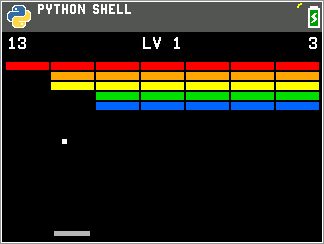

# TI-84 Evo Projects

A collection of games and tools for the **TI-84 Evo** calculator.

## Projects

### PNG2Sprite

> `PNG2Sprite/png_to_sprite.py`

A desktop Python utility that converts PNG images into graphics for TI-84 Python programs. It has two output modes:

- **Sprite data** (default): a `sprites.py` file with palettes and rectangle-encoded sprites to draw with the `ti_draw` API.
- **Calculator images** (`--8xv2`): one `NAME.8xv2` image per PNG, drawn natively with `ti_graphics.drawImage("NAME", x, y)`. This is much faster, since a whole image takes about as long to draw as a single `fill_rect`.

**Requirements:** `Pillow`

```bash
pip install pillow
```

**Usage**

1. Place PNG files in `PNG2Sprite/input/`
2. Run the script from the `PNG2Sprite/` folder:

```bash
python png_to_sprite.py                  # convert every PNG at 100% scale
python png_to_sprite.py 50               # scale every image to 50%
python png_to_sprite.py 100 cloud.png    # convert only the listed files
python png_to_sprite.py --8xv2           # write .8xv2 calculator images
python png_to_sprite.py --max-rects 8    # approximate each sprite with at most 8 rectangles
python png_to_sprite.py --fill           # fill holes to make a solid silhouette
```

3. Output appears in `PNG2Sprite/output/`

**Sprite data output.** `sprites.py` contains a `NAME_palette` list (24-bit RGB integers) and a `NAME_sprites` dictionary for each image, ready to paste into a TI-84 Python script. Each `fill_rect` call costs about 8 ms on the calculator, so fewer colors and `--max-rects` keep moving sprites fast.

**.8xv2 output.** The file name becomes the calculator variable name, so PNG names must be 8 characters or fewer, using only letters and digits and starting with a letter. Send the `.8xv2` files to the calculator with your Python program. Transparent pixels stay transparent.

**Settings.** The constants at the top of the script control the defaults: `COLORS` (number of colors kept, 1 by default), `REMOVE_HALO` / `HALO_LEVEL` (removes near-white anti-aliasing fringe around the edges), `SMOOTH_SCALE` (nearest-neighbor or smooth resizing), and `MAX_WIDTH` / `MAX_HEIGHT`.

---

### Snake

> `Snake/SNAKE.py`

Classic Snake game. Navigate the snake to eat apples without hitting the walls or yourself.


---

### Blackjack

> `Blackjack/BLCKJACK.py`

A fully-featured Blackjack game.

  

**Features**
- Betting screen with balance tracking (starts at $500)
- Dealer hides second card until player stays
- Dealer draws to soft 17
- 5-Card Trick: collect 5 cards without busting to auto-win

---

### Breakout

> `Breakout/BREAKOUT.py`

Classic brick-breaker. Move the paddle left and right to bounce the ball and clear every brick on the board.



**Features**
- 5 rows of colored bricks worth 1–5 points
- Paddle with momentum; where the ball hits the paddle controls its bounce angle
- 6 rotating brick patterns, with the ball speeding up each level
- Pause support

---

### T-Rex Runner

> `T-Rex Runner/TREXRUN.py`

My take on the famous Chrome Dinosaur Game. Jump over cacti and duck under pterodactyls as the game speeds up.


**Controls**
- `[up]`: jump (or start / play again)
- `[down]`: duck, or fall faster in the air
- `[2nd]`: pause
- `[clear]`: quit

**Installation:** send `TREXRUN.py` and every `.8xv2` file in `T-Rex Runner/images/` to the calculator. The sprites were made with PNG2Sprite's `--8xv2` mode.

---
