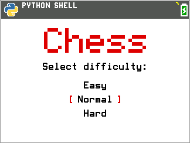
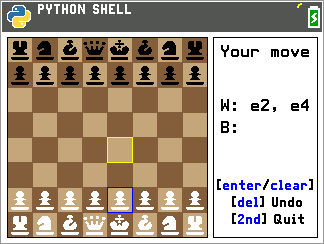
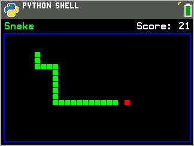
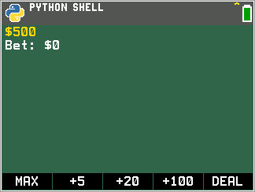
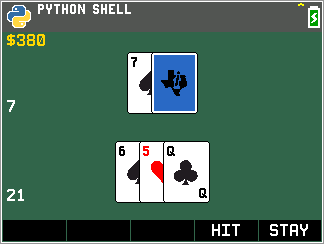
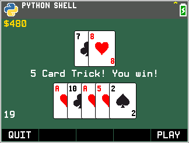
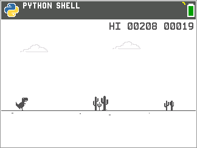

# TI-84 Evo Projects

A collection of games and tools for the **TI-84 Evo** calculator.

## Projects

### PNG2Sprite

> `PNG2Sprite/png_to_sprite.py`

A desktop Python utility that converts PNG images into graphics for TI-84 Python programs. It has two output modes:

- **Sprite data** (default): a `sprites.py` file with palettes and rectangle-encoded sprites to draw with the `ti_draw` API.
- **Calculator images** (`--8xv2`): one `NAME.8xv2` image per PNG, drawn natively with `ti_graphics.drawImage("NAME", x, y)`. This is much faster, since a whole image takes about as long to draw as a single `fill_rect`.

**Requirements:** `Pillow`

```bash
pip install pillow
```

**Usage**

1. Place PNG files in `PNG2Sprite/input/`
2. Run the script from the `PNG2Sprite/` folder:

```bash
python png_to_sprite.py                  # convert every PNG at 100% scale
python png_to_sprite.py 50               # scale every image to 50%
python png_to_sprite.py 100 cloud.png    # convert only the listed files
python png_to_sprite.py --8xv2           # write .8xv2 calculator images
python png_to_sprite.py --8xv2 --opaque  # .8xv2 images with a solid background
python png_to_sprite.py --bytes          # pack sprite rectangles as bytes literals
python png_to_sprite.py --max-rects 8    # approximate each sprite with at most 8 rectangles
python png_to_sprite.py --fill           # fill holes to make a solid silhouette
```

3. Output appears in `PNG2Sprite/output/`

**Sprite data output.** `sprites.py` contains a `NAME_palette` list (24-bit RGB integers) and a `NAME_sprites` dictionary for each image, ready to paste into a TI-84 Python script. Each `fill_rect` call costs about 8 ms on the calculator, so fewer colors and `--max-rects` keep moving sprites fast.

**Bytes format** (`BYTES = True`, the default, or `--bytes`). Each color's rectangles are stored as one `bytes` literal, 4 bytes (x, y, w, h) per rectangle, instead of a list of packed integers. `sprites.py` also includes a `draw_sprite(x, y, NAME_palette, NAME_sprites)` helper to draw them. This is about 30% smaller once compiled with Python2Byte and uses far less RAM, since each color is a single object. Images must be 255 x 255 or smaller; set `BYTES = False` for the older list-of-ints format.

**.8xv2 output.** The file name becomes the calculator variable name, so PNG names must be 8 characters or fewer, using only letters and digits and starting with a letter. Send the `.8xv2` files to the calculator with your Python program. Transparent pixels stay transparent, unless you use `--opaque`, which fills the background with `OPAQUE_BG` (white by default). An opaque sprite redrawn over itself covers its old frame, so a sprite moving on a plain background needs no erase and doesn't flicker.

**Settings.** The constants at the top of the script control the defaults: `COLORS` (number of colors kept, 1 by default), `REMOVE_HALO` / `HALO_LEVEL` (removes near-white anti-aliasing fringe around the edges), `SMOOTH_SCALE` (nearest-neighbor or smooth resizing), `MAKE_8XV2`, `OPAQUE` / `OPAQUE_BG`, `BYTES`, and `MAX_WIDTH` / `MAX_HEIGHT`.

---

### Python2Byte

> `Python2Byte/build_8mp2.py`

A desktop Python utility that compiles a TI-84 Python program to MicroPython bytecode and packages it as a calculator module (`.8mp2`). It also writes a small launcher `.py` that imports the module. Your program then runs from the calculator's Python app like any other script. The calculator skips parsing and compiling at startup, and the source code isn't shipped.

**Requirements:** `mpy-cross` 1.17. The calculator needs `.mpy` format version 5, and newer releases of `mpy-cross` produce a different format.

```bash
pip install mpy-cross==1.17
```

**Usage**

1. Place your `.py` file in `Python2Byte/input/`
2. Edit the settings at the top of `build_8mp2.py`:

```python
NEW_PY_NAME = "TEST"         # launcher name (what you run on the calculator)
NEW_MOD_NAME = "TESTM"       # module name (the .8mp2 file)
OPTIMIZE = True               # compile with -O3
```

3. Run the script:

```bash
python build_8mp2.py
```

4. Output appears in `Python2Byte/output/`:
   - `<NEW_MOD_NAME>.8mp2`: the compiled program
   - `<NEW_PY_NAME>.py`: the launcher
5. Send both files to the calculator and run `<NEW_PY_NAME>` from the Python app.

**Naming rules.** `NEW_MOD_NAME` must be 1 to 8 characters, using only letters and digits and starting with a letter. It is uppercased automatically. The two names must be different.

**Input file.** If `input/` holds a single `.py` file, that file is built. If it holds several, the script builds the one named `<NEW_PY_NAME>.py`.

**Optimize.** With `OPTIMIZE = True`, the program is compiled with `-O3`. The output is about 7% smaller and `assert` statements are removed, but errors on the calculator no longer show line numbers. Leave it `False` while debugging.

**Missing module.** If the `.8mp2` file isn't on the calculator, the launcher prints a message asking you to send it, so you don't get a bare `ImportError`.

---

### Chess

> `Chess/CHESS.py`

Play chess against the calculator, or watch it play itself.

 

**Features**
- Three difficulty levels: Easy, Normal and Hard (the CPU looks 1, 2 or 3 moves ahead)
- Play as White or Black (the board flips so your pieces are at the bottom), or pick Demo to watch CPU vs CPU
- All the rules: castling, en passant and pawn promotion (always to a queen)
- Detects check, checkmate and draws (stalemate, threefold repetition, the 50-move rule and insufficient material)
- Undo on Easy and Normal
- Score sheet at the end of the game listing every move in algebraic notation

**Controls**
- Arrow keys: move the cursor. Once a piece is selected, they jump between its legal squares
- `[enter]`: select a piece, then move it
- `[clear]`: unselect the piece
- `[del]`: undo your last move (Easy and Normal only)
- `[2nd]`: quit to the title screen
- `[stat]`: show the score sheet after the game ends

**Installation:** send `CHESS.py` and `CHESSM.8mp2` to the calculator, then run `CHESS` from the Python app. The game is compiled to bytecode with Python2Byte, so `CHESS.py` is only a small launcher that loads `CHESSM.8mp2`; it starts faster than the plain script.

**Source:** the full program is in `Chess/raw files/CHESS.py`, which also runs on its own as a regular `.py`. The piece sprites are built into it in PNG2Sprite's bytes format; the PNGs in `Chess/raw files/images/` are the source images.

---

### Keyboard Codes

> `Keyboard Codes/KEYCODES.py`

A small tool that shows the code `ti_system.get_key()` returns for any key you press. Use it to look up key codes when writing your own programs. Press `[clear]` to quit.

---

### Snake

> `Snake/SNAKE.py`

Classic Snake game. Navigate the snake to eat apples without hitting the walls or yourself.



---

### Blackjack

> `Blackjack/BLCKJACK.py`

A fully-featured Blackjack game.

  

**Features**
- Betting screen with balance tracking (starts at $500)
- Dealer hides second card until player stays
- Dealer draws to soft 17
- 5-Card Trick: collect 5 cards without busting to auto-win

**Installation:** send `BLCKJACK.py` and `BLCKJACM.8mp2` to the calculator, then run `BLCKJACK` from the Python app. The game is compiled to bytecode with Python2Byte, so `BLCKJACK.py` is only a small launcher that loads `BLCKJACM.8mp2`; it starts faster than the plain script.

**Source:** the full program is in `Blackjack/raw files/BLCKJACK.py`, which also runs on its own as a regular `.py`. The card and suit sprites are built into it in PNG2Sprite's bytes format; the PNGs in `Blackjack/raw files/images/` are the source images.

---

### Breakout

> `Breakout/BREAKOUT.py`

Classic brick-breaker. Move the paddle left and right to bounce the ball and clear every brick on the board.


**Features**
- 5 rows of colored bricks worth 1–5 points
- Paddle with momentum; where the ball hits the paddle controls its bounce angle
- 6 rotating brick patterns, with the ball speeding up each level
- Pause support

---

### T-Rex Runner

> `T-Rex Runner/TREXRUN.py`

My take on the famous Chrome Dinosaur Game. Jump over cacti and duck under pterodactyls as the game speeds up.



**Controls**
- `[up]`: jump (or start / play again)
- `[down]`: duck, or fall faster in the air
- `[2nd]`: pause
- `[clear]`: quit

**Installation:** send `TREXRUN.py` and every `.8xv2` file in `T-Rex Runner/images/` to the calculator. The sprites were made with PNG2Sprite's `--8xv2` mode.


